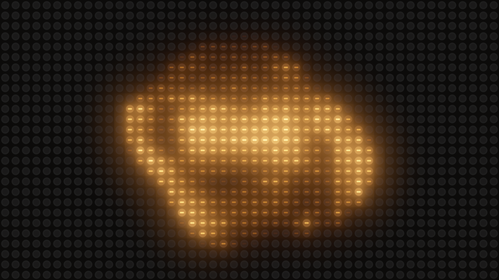
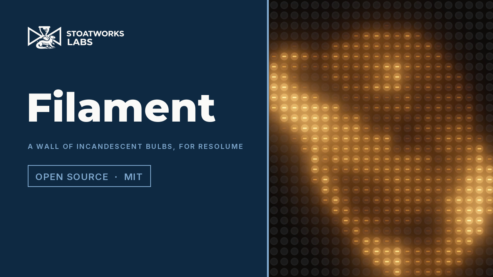

# filament

> **AI-assisted project.** This codebase was created with [Claude](https://claude.com/claude-code)
> (Anthropic), directed and reviewed by a human author. In Resolume Arena 7.29.0 on macOS it
> registers with every control and renders the wall, and with the colour organ Off it draws what
> v0.1.0 draws; the organ has never listened to a live device there. On Windows v0.1.0 passed the
> fleet's Arena gate in Resolume Arena 7.27.1 on software rendering. Everything else is measured
> by an offline harness that drives the plugin class itself, reads each bulb's temperature back through the
> plugin's own probes, and sets it against the heat-balance equation solved independently in
> double: a filament at rated voltage settles at 2800 K to within 0.06 K, its light sits on the
> Planckian locus to 1e-6 in xy, and a cold one reaches 90% in 65 ms where a lamp without
> tungsten's fifteenfold inrush would take 135. Six negative controls show each check can
> fail. The rest is under [Status](#status).

Your picture on a wall of incandescent bulbs, as an FFGL effect for
[Resolume](https://resolume.com) Arena and Avenue. Every bulb is a tungsten filament
with its own heat balance, so fades go warm, flashes come up fast and die away slowly,
and nobody has to get up a ladder to change the blown ones.



<sub>One frame, rendered by `fitest --pipe`, the offline harness, rather than captured from
Resolume. Resolume's bundled demo clip Metalive 01 at the defaults.</sub>

> **Photosensitivity.** The colour organ (new in v0.2.0) pumps whole lamps with the music: the
> bass on the kicks, the treble on the hi-hats. I measured it over the audio of Resolume's
> eighteen demo clips, each through its own video, counting flashes in the whole frame and in
> every third of it. At the defaults it stays at or under **three flashes a second**, the line
> broadcast and web (WCAG) guidance draw: at most 2.5 a second over the whole frame and 3 in a
> third of it, on the Beat loops (the Bass and Synth loops stay dark). With every Gain at its top
> (+60 dB) Beat 003 reached **3.5** a second over the whole frame, and with a 10 W lamp as well
> every Beat loop crossed the line in a third of the frame, up to **4** a second. Louder or busier music
> than the demo loops can go further. Flashing like that can trigger seizures in people with
> photosensitive epilepsy. With the organ Off the wall is v0.1.0's. See
> [Photosensitivity](https://stoatworks-labs.com/software/filament/guide/#photosensitivity) in
> the guide.

<!-- downloads:start -->

## Download

**[v0.1.0](https://github.com/stoatworks-labs/filament/releases/tag/v0.1.0)** — prebuilt for macOS and Windows. Pick your platform:

<details>
<summary><b>macOS</b> — Universal (Apple Silicon + Intel)</summary>

| Build | Download | Size |
| --- | --- | --- |
| Universal (Apple Silicon + Intel) · .dmg disk image | [`filament-0.1.0-macos-universal.dmg`](https://github.com/stoatworks-labs/filament/releases/download/v0.1.0/filament-0.1.0-macos-universal.dmg) | 235 KB |
| Universal (Apple Silicon + Intel) · .zip archive | [`filament-macos-universal.zip`](https://github.com/stoatworks-labs/filament/releases/latest/download/filament-macos-universal.zip) | 197 KB |

</details>

<details>
<summary><b>Windows</b> — x64</summary>

| Build | Download | Size |
| --- | --- | --- |
| x64 · .exe installer | [`filament-0.1.0-windows-x86_64-setup.exe`](https://github.com/stoatworks-labs/filament/releases/download/v0.1.0/filament-0.1.0-windows-x86_64-setup.exe) | 228 KB |
| x64 · .zip archive | [`filament-windows-x86_64.zip`](https://github.com/stoatworks-labs/filament/releases/latest/download/filament-windows-x86_64.zip) | 122 KB |

</details>

All builds, checksums and release notes: [github.com/stoatworks-labs/filament/releases](https://github.com/stoatworks-labs/filament/releases).

macOS builds are signed and notarised and open normally. The Windows builds are unsigned, so SmartScreen warns once.

<!-- downloads:end -->

## Video

[](https://www.youtube.com/watch?v=rJRPgKvLfSk)

## The one idea

An incandescent bulb is a tungsten wire heated by current, which is a different beast
from an LED with a slow fade. Its light comes from its **temperature**, and its temperature follows the wire's
heat balance: electrical power in, through a resistance that changes with temperature;
radiated power out, as T⁴; conducted power out; all against the wire's heat capacity.

So each bulb on the wall has its dimmer set by its cell of the clip, and its
filament does the rest.

## What falls out

None of this is drawn. It's the filament doing what filaments do:

- **Warm fades.** Dim a bulb and it doesn't just get darker, it gets redder: its light is
  Planck's law at the filament's temperature, integrated against the CIE colour-matching
  functions. A 60 W bulb is 2816 K at full and 1975 K at 45%, and its colour follows.
- **A fast rise and a slow fall.** Heating is driven by the power in; cooling by radiation,
  which falls as T⁴, so a cooling wire slows as it goes. A flash comes up in tens of
  milliseconds and dies away in hundreds, and a moving picture smears into a warm trail.
- **Inrush.** Cold tungsten has a fifteenth of its hot resistance, so a cold bulb draws
  fifteen times its rated power and heats twice as fast as its steady time constant says.
- **Mains ripple.** The drive is the mains waveform through a dimmer (a sine-wave
  dimmer, a square-law one, or a leading-edge triac that chops each half-cycle), so every
  filament's temperature ripples at twice the mains. A small filament ripples a lot, a big
  one hardly at all.
- **Big lamps are slow.** Each lamp's wire is sized from its wattage and voltage, so its
  heat capacity is too: a 1000 W lamp lags, a 10 W one snaps, and a 120 V lamp is
  sluggier than a 230 V lamp of the same wattage.

### The honest limit

The equation is the physics, but three of its numbers are assumptions: the wire's
emissivity (0.30), how much of a coiled coil's surface radiates (half), and how much of
the power leaves by conduction (15%). Together they set how heavy each wire is, and so
every time constant; they give a 60 W 230 V filament of 34 µm by 0.92 m, which is the
right size, but no real lamp has been measured against the model. The filament's colour
is a black body's; real tungsten is a little bluer. The shapes of the bulbs, the halo,
the bloom, the glass and the gels are drawn by eye. And thin, dim features in the clip
vanish, because each bulb sees the average of its whole cell.

## The colour organ (new in v0.2.0)

A 1970s three-channel colour organ in front of the wall. The music goes through a passive
three-way crossover (bass, mid, treble), and each band through a diode and a capacitor into
a control voltage. The control voltage sets how early in each mains half-cycle a triac fires.
Every bulb holds three filaments, one per channel, each behind a LEE gel and a frosted
globe. The clip's brightness in each cell sets how strongly that bulb answers. The
detector values are ETI's Project 428 (1974), the trigger is the ramp-and-unijunction
circuit of that era, the gels are LEE's measured spectra, and filament's own thermal
model does the rest. None of the following is drawn:

- **The bass pumps on the kicks.** On Resolume's Beat demo loops the bass filament swings
  over 1000–2300 K (10th to 90th percentile).
- **A cold lamp lags its first hit**: 97 ms to 90% from cold for a 60 W lamp.
- **The treble settles to a steady glow when the hats are dense enough.** Of the six Beat
  loops it does so on one (Beat 002: 2341–2817 K). On the others it follows the hats.

Turn it on with **Organ → On**, then choose an **Audio Input**. It listens to a microphone
or a loopback device through [earshot](https://github.com/stoatworks-labs/earshot), the
fleet's audio front end, and stays dark until one is chosen: it doesn't use Resolume's own
audio analysis. With the organ Off, the plugin renders exactly as v0.1.0 did and never
touches the audio system. AGENTS.md has the circuit as modelled, what is verified and what
is not.

## Controls

| Group | |
| --- | --- |
| **Wall** | Columns (4–160), Rows (2–90), Gap, Pixel Mode, Glass (Clear, Frosted, Amber, Red, Green, Blue), Gels (Off, RGB: three filaments per cell behind red, green and blue gels). |
| **Bulb** | Wattage (10–1000 W), Dimmer (Linear, Square Law, Triac), Mains (50 Hz / 230 V, 60 Hz / 120 V), Ambient Temp (0–200 °C). |
| **Look** | Glow (the halo from the glass and reflector), Bloom, Exposure (±4 stops), Mix. |
| **Organ** (after About) | Organ (Off, On), Crossover Low (40–500 Hz, default 220), Crossover High (500–8000 Hz, default 1760), Bass, Mid and Treble Gain (−12 to +60 dB), Bass, Mid and Treble Gel (nine LEE gels and Clear; default 106 Primary Red, 139 Primary Green, 119 Dark Blue), Audio Input (remembered by name), Rescan Inputs, Status Lamp. |

The defaults are a 48 × 27 wall of clear 40 W bulbs on 50 Hz square-law dimmers, with a
modest halo and bloom. Square law because tungsten on a plain voltage dimmer is so
contrasty that every mid-grey goes dark; that's what theatre dimmer curves are for.

The light is what a camera's open shutter would collect over the frame, so the 100 Hz
ripple of a 40 W bulb is invisible at 60 fps; a 10 W bulb on a triac keeps a faint 20 Hz
beat, as a small tungsten lamp filmed at 60 fps does. The output is opaque at Mix 1: the
wall paints the whole frame, whatever the clip's alpha.

## Status

**v0.2.0, released 19 November 2026, and still early days.** v0.2.0 adds the
[colour organ](#the-colour-organ-new-in-v020); with it Off, the plugin draws what v0.1.0
(25 September 2026) drew. There's a
[user guide](https://stoatworks-labs.com/software/filament/guide/)
([PDF](docs/USER-GUIDE.pdf)) and a [project page](https://stoatworks-labs.com/software/filament/).

### Measured offline, on macOS

`tools/verify.sh` passes on this Mac (M4 Max, macOS 26.4) against a fresh universal
Release build, running every check at 320×180 and 1280×720 and again on Apple's software
renderer, which is what a GPU-less CI runner has. What it establishes:

- **Steady state.** A 200 W filament at 1.0, 0.7 and 0.4 of its voltage settles at
  2799.95, 2404.28 and 1862.32 K, against a power balance of 2800.00, 2404.32 and
  1862.40 K.
- **Colour.** At five temperatures from 1975 to 2816 K the light's chromaticity is on the
  Planckian locus to 1e-6, its luminance right to 1e-4, and McCamy's CCT of it agrees with
  McCamy's CCT of the true locus to 0.04 K; each dimming step is redder.
- **Rise.** From cold, the rise follows the equation to 0.004 K; 90% in 65.2 ms, where a
  constant-resistance lamp would take 135.3 ms.
- **Fall.** Switched off, the decay follows radiation plus conduction to 0.17 K, reaches
  1500 K in 176 ms, and slows as it goes: its time constant at 1200 K is 2.5 times its
  time constant at 2400 K. An exponential's wouldn't change.
- **Ripple.** Under a triac the temperature ripples at exactly 100 Hz on 50 Hz mains and
  120 Hz on 60 Hz, 137 K peak to peak on a 25 W filament and 18.5 K on a 500 W one.
- **Resize.** An output resize and a change of grid, mid-fade, leave every bulb's
  temperature exactly where it would have been.
- **Negative controls.** A lamp without inrush fails the rise; a linear cooler fails the
  fall; DC fails the ripple; a lamp without conduction fails the steady state; a colour
  table read 5% hot fails the colour; a resize that restarts the wall cold fails the resize.
- **No dead controls**: all 14 change the picture.
- **The bundle** is universal, and oxbow sees `SW Filament`, `FI01`, an effect, and renders
  120 frames through it.

Render cost, `fitest --bench` (best of three, `glFinish` both sides, a shared GPU):

| | default (48 × 27, 40 W) | largest grid (160 × 90, 40 W) | largest, 10 W on RGB gels (worst) |
| --- | --- | --- | --- |
| 1280×720 | 0.25 ms (1.5%) | 0.30 ms | 1.54 ms |
| 1920×1080 | 0.26 ms (1.5%) | 0.38 ms | 1.63 ms |
| 3840×2160 | 0.39 ms (2.3%) | 0.54 ms | 1.78 ms (10.7%) |

(percentages of a 60 fps frame). The equation is solved in 34 to 147 substeps a frame,
depending on the lamp; small lamps need the most.

### The colour organ, measured offline

`tools/verify.sh` runs these too, at both rasters and on the software renderer. Each reads
the plugin's own state or picture:

- **Crossover corners.** At the defaults, the bass band is −6.02 dB at 220.0000 Hz and the
  treble at 1760.05 Hz. That was found by bisection on sines fed through earshot, within
  1.1e-4 relative.
- **Firing angle.** A steady control fires a 200 W lamp at 30°, 60°, 90°, 120° and 150°.
  The lamp's RMS², read back out of its temperature, comes out as 0.98541, 0.89681,
  0.70698, 0.44208 and 0.16978. Phase control's closed form, 1 − α/π + sin 2α / 2π, gives
  0.98548, 0.89694, 0.70711, 0.44216 and 0.16981 (tolerances 0.00009–0.00026).
- **Step response.** From cold, a 60 W lamp follows the lamp's ODE through the cut sine to
  0.19 K (tolerance 0.76). It reaches 90% in 96.88 ms; the ODE says 96.88 ms.
- **Detector.** Each band releases with ETI 428's R19·C, 100 ms and 47 ms, to 1e-13.
- **Colour.** Each filament's light is its own gel's at its own temperature, to 4e-7.
- **Frame rate and clock.** Every half-cycle's control is bit-identical at 30, 60 and
  144 fps, and with the host's clock 5.8 days in.
- **Resize.** A resize or a grid change mid-music keeps every filament exactly.
- **Organ off is v0.1.0.** 13 renders, 30 piped frames and the first 19 parameters are
  identical to a build of the v0.1.0 tag. With the organ Off, the real CoreAudio backend
  sees no engine, no device list and no audio thread.
- **Negative controls and mutants.** Each organ check has a perturbation that makes it
  fail. `tools/mutate.sh` makes 20 one-character mutants of the organ's C++ and GLSL, and
  a check catches all 20. Every swept control moves the picture.

Render cost with the organ on, the synthetic track fed before each frame: 0.72 ms at
1280×720 and 1920×1080, 0.75 ms at 3840×2160 (0.25, 0.26 and 0.39 off).

### In Resolume Arena, on macOS

v0.2.0 (a universal build of the release source) in Resolume Arena 7.29.0 on this Mac,
driven over Arena's REST API on a still card: it registers as `SW Filament` with Opacity and
all 31 of its controls, the 12 organ controls among them, with the defaults and options it
declares, and About reads `Filament v0.2.0`. With the organ Off, six settings (the defaults,
RGB gels, 10 W on a triac, 160 × 90, Amber glass and Mix 0.5) came out 0.003 to 0.55 levels
(of 255) from v0.1.0's release bundle at the same settings, against v0.1.0's own spread of
0.03 to 0.86 between two snapshots 1.5 s apart; Mix 0 is the bare clip exactly. Organ On with
Audio Input None goes dark (the frame's mean 115 → 19) with the status lamp amber in the
top-right corner, and Status Lamp Off takes the lamp away. With no input, every Gain at
+60 dB, the crossovers at their ends and the gels changed change nothing. The Audio Input
menu lists the Mac's inputs and stayed on None: no device was opened, so the organ has not
heard live audio in Arena.

### In Resolume Arena, on Windows

v0.1.0: a build of this source loads, registers and renders in Resolume Arena 7.27.1 on software rendering (win-lab, Mesa llvmpipe, no GPU), with every control matching what the plugin declares and all 14 moving the picture, in the fleet's Arena gate (9 of 9 checks). The gate's picture is a still, so Wattage, Mains and Ambient Temp, which act mostly on how the wall moves, read weakly there (about 4.6 to 5 levels against a noise floor of 1.1, where the other controls read 10 to 55); software rendering says nothing about a GPU or about speed.

v0.2.0: the colour organ is compiled into the Windows DLL (CI's MSVC build compiles
earshot, miniaudio and the organ), and it has never run on Windows. The release's own DLL
goes through the same gate, with the organ's rows added, after the tag; the result will be
here.

### What filming the release video found

The video is rendered through `fitest --pipe` over Resolume's demo clips. Filming turned up
no defects, and four facts that are now in the guide: a 1000 W wall barely registers a quick flash (the
wall's mean moved 43 → 55 across a flash that takes the 40 W wall 30 → 97) and glows on after
it; a Linear dimmer leaves only the highlights (a face's mean 52 → 25); behind RGB gels the
blue is nearly dark; and the mains ripple is averaged away by a 30 fps shutter, so the video
doesn't show it (the harness measures it).

### Open questions about the organ

Released as built, with these left open:

- **No input, no light.** The organ is dark until an Audio Input is chosen, and the default is
  None. It doesn't fall back on Resolume's own audio analysis: that gives band levels, and the
  organ's crossover and triacs need the waveform.
- **No preheat.** There's no Background control holding idle lamps just below glowing, as
  most period organs had, so a channel under half its control is fully dark.
- **Frosted is forced** while the organ is On; Glass's tint is kept, its shape isn't.
- **Blue is dim.** 119 Dark Blue passes about a fifth of 106 Primary Red's luminance on
  tungsten, by LEE's own transmission data.
- **Line art stays dark.** Each bulb's sensitivity is its cell's brightness, so Resolume's Bass
  and Synth clips (lines on black) barely light at the defaults.
- **The treble holds a glow only on dense hi-hats** (one Beat clip of six) with the default
  40 W lamp; a bigger lamp would hold it longer.
- **Dimmer and the wall's Gels do nothing** while the organ is On: its triacs and gels replace
  them.

### Not done

- **The colour organ has never heard a live audio device**, in Resolume or anywhere: every
  check feeds the audio in through earshot's test path. The microphone permission prompt is
  untested, and the organ has never run on Windows.
- Seen only on Resolume's bundled demo clips, never on camera footage.
- No OpenFX port, no factory presets.

## Browser demo

[filament-demo.stoatworks-labs.com](https://filament-demo.stoatworks-labs.com/)
runs the plugin's own shaders in WebGL2 (the drive, thermal, bloom and output
passes, the colour organ's pass and the filament library they share), spliced in
from `source/Shaders.cpp` by `demo/tools/sync_shaders.py`.
`demo/tools/check_shaders.py`, from `tools/verify.sh`, checks them character for
character, along with the lamp's tables, the Planck table and the gel table. So
the heat balance runs on the GPU as in the plugin: RK4 substeps over a float
temperature per bulb, ping-ponged. The colour organ's audio half is the plugin's
own C++ (`source/Organ.cpp` and earshot) compiled to WebAssembly by
`demo/tools/build-wasm.sh`, and the same check fails if the `.wasm` was not built
from the sources as they are. It hears a generated test track (fitest's), silence,
or a file you pick, which stays in the page: never a microphone. Compared once
against a native build on the same audio, every row was bit-identical (AGENTS.md).
The rest of the CPU half (the clock and the mains phase, the lamp's wire sized
from its wattage, the substep rule, the organ's ramps and status lamp, and every
control's law) is a **hand port to JavaScript**, and nothing checks a port but a
reader. The emissivity, the radiating fraction and the conducted share are the
plugin's assumptions there as here. The page opens with the Organ Off, as the
plugin does, under a photosensitivity note. Columns and Rows are dropdowns (the
kit has no integer control). It's served from `demo/` by this repo's own Worker
and redeploys on every push to main.

## Build

Needs CMake 3.15+, a C++17 compiler and the FFGL SDK submodule.

```sh
git clone --recurse-submodules https://github.com/stoatworks-labs/filament
cd filament
cmake -B build -DCMAKE_BUILD_TYPE=Release
cmake --build build --parallel
```

The macOS bundle is universal (Apple Silicon and Intel). `cmake --install build` copies
it into `~/Documents/Resolume Arena/Extra Effects`; for Avenue, pass
`--prefix "$HOME/Documents/Resolume Avenue/Extra Effects"`.

## Building and testing

```sh
tools/verify.sh                                   # everything, ~4 minutes
./build/fitest --list                             # the parameters
./build/fitest --rise --size 320x180              # one check
./build/fitest --negative                         # every check can fail
python3 tools/sweep.py                            # no dead controls
python3 tools/planck_table.py --check             # the colour table recomputes
ffmpeg -i clip.mov -f rawvideo -pix_fmt rgba - | ./build/fitest --pipe --size 1280x720 --fps 30 | ffplay -f rawvideo -pixel_format rgba -video_size 1280x720 -
```

`CLAUDE.md` is the command reference and `AGENTS.md` the reasoning: the lamp model, the
traps, and where every tolerance comes from.

## License

MIT — see [LICENSE](LICENSE). The CIE 1931 colour-matching functions, the tungsten
resistivity table and the heat-capacity fit are published data; their sources are in
[ATTRIBUTIONS.md](ATTRIBUTIONS.md). The colour organ adds a vendored snapshot of
Stoatworks earshot (MIT, with miniaudio inside it) in `external/earshot/`, and LEE
Filters' published gel transmission curves in `tools/data/lee_gels.csv`.

<!-- attributions:start -->
This project is built on other people's work — see [ATTRIBUTIONS.md](ATTRIBUTIONS.md).
<!-- attributions:end -->
