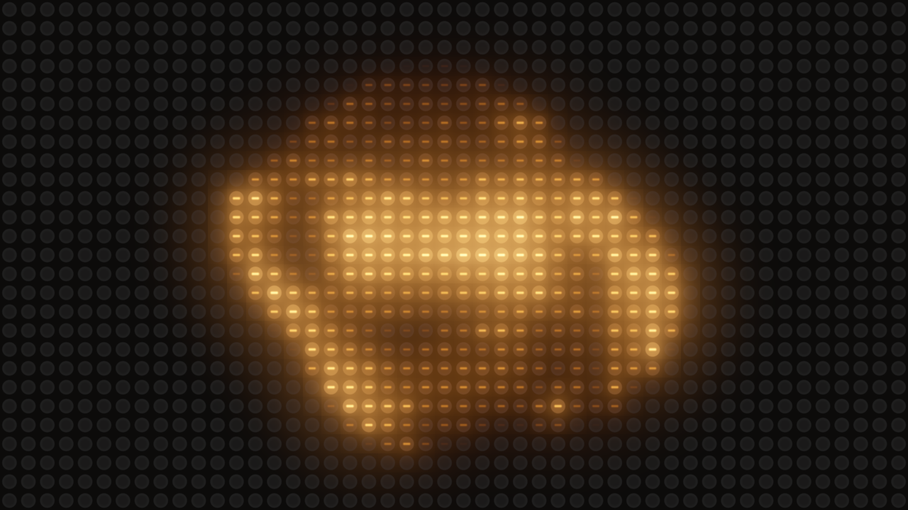

# Filament user guide

Filament is **a wall of incandescent bulbs, for [Resolume](https://resolume.com) Arena and
Avenue**, as an FFGL effect. Each bulb is a tungsten wire heated by current, with its dimmer set
by its cell of the clip, and its light comes from how hot the wire gets.

There are no glowing dots with a slow fade here. The mains drives each bulb through its dimmer,
and the wire's own heat balance decides how hot it gets and how fast. Dimmed bulbs going red as
well as dark, flashes that come up fast and die away slowly, the surge of a cold bulb, the lag of
a big lamp and the ripple of a small one all come from the filament rather than from anybody
drawing them.



*Resolume's bundled demo clip Metalive 01 through the plugin at its defaults, rendered by the
offline harness rather than captured from Resolume: a 48 × 27 wall of clear 40 W bulbs on 50 Hz
square-law dimmers. The bright tiles are filaments near 2800 K, nearly white; the dim ones are
cooler and so redder; the unlit bulbs are faint discs of glass.*

> **Before you rely on this:** released at **v0.2.0**, which adds the
> [colour organ](#the-colour-organ-new-in-v020), and still early days. The filaments are
> measured rather than just asserted, by a harness that drives the plugin class itself and reads each
> bulb's temperature back through the plugin's own probes, at two rasters and on a software
> renderer: at a steady voltage a filament settles where power in balances power out (at rated
> voltage 2799.95 K against 2800); its light sits on the Planckian locus to 1e-6 in xy and moves
> redward with every step down; a cold start follows the heat-balance equation to 0.004 K and
> reaches 90% in 65 ms, where a lamp without tungsten's fifteenfold inrush would take 135; a
> switched-off filament cools by T⁴ radiation plus conduction, its time constant 2.5 times longer
> at 1200 K than at 2400 K; a triac-dimmed filament ripples at exactly twice the mains, 7.4 times
> more on a 25 W lamp than a 500 W one; and a resize mid-fade keeps every temperature exactly. Six
> deliberately broken models are each shown to fail their check. All 14 controls are shown to
> change the picture. **The checks verify the stated model, not a real lamp**: three of its
> constants are assumptions (see Known limits), and no real bulb has been measured against it.
> In **Resolume Arena 7.29.0 on macOS**, v0.2.0 registers with every control as declared, and
> with the colour organ Off it draws what v0.1.0 draws there (within 0.55 levels of 255, inside
> v0.1.0's own spread between two snapshots); the organ, On with no input, goes dark with its
> status lamp amber, as it should. The organ has never listened to a live audio device.
> On Windows, v0.1.0 loads, registers and renders in Resolume Arena 7.27.1 on
> software rendering (win-lab, Mesa llvmpipe, no GPU), with every control matching what the
> plugin declares and all 14 moving the picture, in the fleet's Arena gate (9 of 9 checks). The
> gate's picture is a still, so Wattage, Mains and Ambient Temp, which act mostly on how the wall
> moves, read weakly there (about 4.6 to 5 levels against a noise floor of 1.1, where the other
> controls read 10 to 55). Software rendering says nothing about a GPU or about speed. v0.2.0's
> Windows DLL has the colour organ compiled in, and the organ has never run on Windows.
> Try it on a spare layer before you put it in a show.
>
> This codebase was created with AI assistance, directed and reviewed by a human author.

> **Photosensitivity.** With the colour organ Off the wall flashes only where the clip does. **The
> organ can flash**: it pumps whole lamps on the kicks and the hi-hats. At its defaults it stayed
> at or under three flashes a second over the audio of Resolume's 18 demo loops, but with every
> Gain at its top it crossed the line on one Beat loop, and with a 10 W lamp as well on all six
> Beat loops over a third of the picture (up to four a second). See [Photosensitivity](#photosensitivity)
> for the rates, and check your music and settings before you put this in front of an audience.

---

## Installing

Every download has one effect in it, **SW Filament**. Drop it into Resolume's effects folder and
restart Resolume:

```
macOS    ~/Documents/Resolume Arena/Extra Effects/
Windows  %USERPROFILE%\Documents\Resolume Arena\Extra Effects\
```

Avenue uses the same layout under its own folder name. The effect then appears in the effects
browser as **SW Filament**.

The macOS download is a universal build (Apple silicon and Intel), as a `.dmg` or a `.zip`. It's
Developer ID-signed and notarised by the release pipeline after publication, so the bundle just
loads. If macOS refuses a download, it's from before the signing, so download it again. The
Windows download is an x64 installer or a `.zip`. It isn't code-signed, so the installer trips
SmartScreen once: **More info** → **Run anyway**.

---

## A bulb is a wire, not a fade

An incandescent bulb is a tungsten wire heated by the current through it. Its temperature follows
one equation, and each bulb of the wall solves it for itself, on the GPU, every frame:

    C(T) dT/dt  =  V(t)² / R(T)  −  ε σ A (T⁴ − T₀⁴)  −  k (T − T₀)

power in, through a resistance that rises with temperature; power radiated, as the fourth power of
temperature; power conducted away to the lead-in wires and supports; all against the wire's heat
capacity. Each term makes something you can see:

| the term | what comes out |
| --- | --- |
| the light is Planck's law at T through the CIE 1931 observer | **warm fades**: a dimmed bulb goes red as well as dark. A 60 W bulb is 2816 K at full and 1975 K at 45%, and its colour follows |
| radiation goes as T⁴ | **a fast rise and a slow fall**: a 60 W bulb reaches 90% of its rise in 65 ms and takes 176 ms to cool to 1500 K, and the cooling slows as it goes |
| tungsten's resistance is 15 times lower cold than hot | **inrush**: a cold bulb draws fifteen times its rated power and heats twice as fast as a constant-resistance bulb would |
| the voltage is the mains, through a dimmer | **mains ripple** at exactly twice the mains frequency, large on a small filament, almost nothing on a big one |
| the heat capacity is the wire's mass | **big lamps are slow, small lamps quick**: each lamp's wire is sized from its wattage and voltage, so a 1000 W filament weighs over a thousand times what a 10 W one does |

Every lamp is designed the same way: it dissipates its rated wattage at the mains voltage with the
wire at **2800 K** in a 25 °C room, and 15% of that power leaves by conduction. So every lamp at
full reads the same colour and the same brightness. Wattage changes how the wall **moves**, not
how bright it is.

---

## Start here

Put SW Filament on a layer or a clip with **some brightness and some movement**, such as the
bundled Metalive, IntoTheGlow_02 or Beat 001 loops. Out of the box you get a 48 × 27 wall of clear 40 W
bulbs on 50 Hz square-law dimmers, with a modest halo and bloom.

Then:

1. **Mix → 0 and back.** Compare the clip with the wall. Where the clip is bright the bulbs are
   near white; where it's mid-grey they're orange; where it's dark they're off, and you see
   the glass.
2. **Wattage → 1000 W.** Watch a flash or a fast move. The heavy wires barely register a quick
   flash and glow on after it, and movement smears into a warm trail. **→ 10 W** and the wall
   follows the clip almost frame for frame.
3. **Dimmer → Linear.** A plain sine-wave dimmer: light from tungsten goes as roughly the 3.4th
   power of the voltage, so the mid-greys go dark and red and only the highlights stay. **→
   Triac** chops each half-cycle instead, and sits between. Back to **Square Law**, which is what
   theatre dimmer curves are for.
4. **Gels → RGB.** Three filaments per cell behind red, green and blue gels, drawn as one bulb:
   the wall now carries the clip's colour. Blue is dim, because tungsten makes little blue light.
5. **Glass → Frosted**, then **Amber**. A frosted globe glows all over instead of showing its
   coil; coloured glass tints the light.
6. **Columns → 160, Rows → 90.** A finer wall. Changing the grid keeps every filament's
   temperature. **Pixel Mode** on draws each bulb as a flat square of its cell.
7. **Exposure** up or down: the wall's camera exposure, in stops.

**Thin, dim features vanish.** Each bulb sees the average of its whole cell of the clip, so a thin
line on black averages to almost nothing, and red has a luma of only 0.21. Lift a dark clip with a
brightness or levels effect ahead of the plugin, or use a finer grid.

Every slider is declared to the host as 0 to 1. The value each position stands for is given with
each control below.

---

## The Wall group

**Columns** (4 to 160, default 48) and **Rows** (2 to 90, default 27). The number of bulbs across
and down. Each bulb's dimmer is the average of its cell of the clip. The bulbs are square cells of
the grid stretched to the frame, so 48 × 27 is square bulbs on a 16:9 frame. A change regrids the
filaments: each new bulb takes the temperature of the old bulb nearest it, so a change mid-fade
carries on from where the wall was.

**Gap** (0 to 0.8 of the cell, default 0.24, slider 0.3). The dark space between bulbs. 0 packs the
bulbs edge to edge; 0.8 leaves small points of light.

**Pixel Mode** (off). Each bulb is drawn as a flat square filling its cell (less the gap) instead
of a bulb with a coil in a glass. The filaments, the colour and the timing are unchanged. It reads
best on a coarse wall: at 160 × 90 the squares are a few pixels across and look much like the
bulbs.

**Glass** (Clear). What the bulb's envelope is:

| | |
| --- | --- |
| Clear | the coil shows as a bright bar in the middle of a lit disc |
| Frosted | the whole globe glows evenly, a little dimmer |
| Amber, Red, Green, Blue | coloured glass: the filament's light times the glass's transmittance |

The coloured glasses' transmittances are chosen by eye, as the look of each glass, not measured
from a filter.

**Gels** (Off, RGB). RGB puts three co-located filaments in every cell, behind red, green and blue
gels, each driven by its own channel of the clip, and draws them as one bulb. That's how a bulb
wall shows colour. Tungsten at 2800 K has much more red than blue in it, so the blue gel is dim;
that's been left in rather than trimmed. RGB costs three filaments per cell.

---

## The Bulb group

**Wattage** (10 to 1000 W, logarithmic, default 40 W, slider 0.301). The lamp every bulb is. It
sets the wire's size and so its heat capacity, and so every time constant of the wall. From the
model at 50 Hz / 230 V, rounded:

| | 10 W | 40 W | 100 W | 1000 W |
| --- | --- | --- | --- | --- |
| wire | 10 µm × 0.51 m | 26 µm × 0.81 m | 47 µm × 1.10 m | 219 µm × 2.36 m |
| 90% of the rise from cold | 20 ms | 49 ms | 91 ms | 420 ms |
| full to 1500 K when switched off | 53 ms | 134 ms | 247 ms | 1.15 s |
| triac ripple at a half setting | 242 K | 97 K | 53 K | 11 K |

(The rise and fall figures are the model's at a steady voltage, not a measured lamp; the harness
measures the 60 W case directly: 65 ms and 176 ms.) Wattage is dynamics, not brightness: every lamp
at full is 2800 K and reads the same.

**Dimmer** (Linear, Square Law, Triac; default Square Law). How the clip's value becomes a
voltage. All three keep the mains waveform; only the triac chops it.

| | |
| --- | --- |
| Linear | a sine-wave dimmer: RMS voltage = the level. Tungsten's light rises as about the 3.4th power of the voltage, so this is very contrasty — mid-greys go dark and red |
| Square Law | RMS voltage squared = the level, so electrical power roughly follows the fader. The default, and what theatre dimmer curves exist for |
| Triac | a leading-edge phase-cut dimmer, firing at (1 − level) of each half-cycle: the real electronics of most wall dimmers. The ripple is largest here |

**Mains** (50 Hz, 60 Hz). The supply: 50 Hz is a 230 V lamp, 60 Hz a 120 V one. It sets the
ripple's frequency (100 or 120 Hz) and, because a 120 V lamp of the same wattage has a thicker,
shorter wire, it makes the lamp slower: a 40 W 120 V lamp takes 76 ms to 90% where a 230 V one
takes 49.

**Ambient Temp** (0 to 200 °C, default 25 °C, slider 0.125). The room the wire loses heat to. A
hot ambient means a slightly hotter unlit filament and slightly slower cooling at the bottom; it
barely matters above a dull red.

**Why you rarely see the ripple.** The picture each frame shows is the light averaged over the
frame, as a camera's shutter would collect it. A 100 Hz ripple averages out over a 1/60 s or
1/30 s frame almost entirely: at the defaults the frame-to-frame variation on a flat grey is ±0.3%,
about one code value. A 10 W bulb on a triac at 50 Hz keeps a faint ±1% beat at 60 fps, which is
what filming a small tungsten lamp at 60 fps looks like. At 60 Hz mains and 60 fps there's none.

---

## The Look group

**Glow** (0 to 1, default 0.5). The halo each bulb throws from its glass and reflector onto its
neighbours' cells.

**Bloom** (0 to 1, default 0.35). A wider blur of the wall's light, as a lens flares around a
bright lamp.

**Exposure** (−4 to +4 stops, default 0, slider 0.5). The wall's camera exposure: the light goes
through `1 − exp(−g × 2^stops × L)` per channel, so bright bulbs roll off softly into white
rather than clipping. Raise it to see dim filaments; lower it to keep the hot ones from going
white.

**Mix** (0 to 1, default 1). The wall over the clip. At 1 the output is opaque: the wall paints
the whole frame, whatever the clip's alpha. At 0 it's the clip, with the clip's own alpha.

---

## The colour organ (new in v0.2.0)

> **New in v0.2.0.** In Resolume Arena 7.29.0 on macOS the organ's 12 controls register as
> declared, and On with no input it goes dark with the status lamp amber. It has never
> listened to a real audio device: every check feeds it recorded or synthetic audio through
> the audio library's test path. It is compiled into the Windows build, and has never run
> there. **It can flash**: see [Photosensitivity](#photosensitivity).

The **Organ** group, after About, turns the wall into a 1970s three-channel colour organ.
The music goes through a passive three-way crossover into bass, mid and treble. Each band
goes through a diode and a capacitor into a control voltage. Each control voltage sets how
early in every mains half-cycle a triac fires its lamp. Every bulb holds three filaments,
one per channel, each behind a LEE gel and a frosted globe. The clip's brightness in each
cell sets how strongly that bulb answers, so the picture stays visible as a pattern of
lamps.

None of what you see is animated by hand. It comes from the circuit and the filament:

- **The bass pumps on the kicks.** The bass detector releases in 100 ms, so it lets go
  between kicks, and the filament heats and cools with it.
- **A cold lamp lags its first hit.** A 60 W filament takes about 97 ms to reach 90% from
  cold.
- **The treble glows steadily only when the hats are dense.** Its detector releases in
  47 ms, and a 40 W filament cools fast enough to follow most hi-hat patterns. On five of
  Resolume's six Beat loops the treble lamp flickers with the hats; on Beat 002 it holds
  a steady glow. A bigger Wattage smooths it.

### Start here

1. **Organ → On.**
2. **Audio Input →** your microphone, a loopback device, or **System default**. Until you
   choose one the organ has nothing to listen to and the lamps stay dark. The status lamp
   in the top-right corner shows amber. Choosing a device opens it, and that is when macOS
   asks whether Resolume may use the microphone (not yet seen in Resolume).
3. Play music. The status lamp turns green when audio arrives.
4. Put a bright clip under it. A dark clip gives dark lamps: see below.

### The controls

**Organ** (Off, On; default Off). With it Off, the plugin renders exactly as v0.1.0 did
and never touches the audio system.

**Crossover Low** (40 to 500 Hz, default 220) and **Crossover High** (500 to 8000 Hz,
default 1760). Bass is below Low, mid between the two, treble above High. Each is a
second-order Linkwitz–Riley filter, 6 dB down at its corner. The defaults are ETI's 1974
Project 428 split: up to the A below middle C, then three octaves.

**Bass Gain, Mid Gain, Treble Gain** (−12 to +60 dB; defaults 48, 51 and 46 dB). How much
of each band reaches its triac. More gain fires the triac earlier in each half-cycle, so
the lamp runs hotter. The defaults suit full-frame footage at ordinary brightness.

**Bass Gel, Mid Gel, Treble Gel** (defaults 106 Primary Red, 139 Primary Green, 119 Dark
Blue). The gel in front of each channel's lamp, from LEE's published transmission curves:
106 Primary Red, 139 Primary Green, 119 Dark Blue, 132 Medium Blue, 120 Deep Blue, 101
Yellow, 105 Orange, 020 Medium Amber, or Clear. Where channels fire together their colours
add, so red and green make yellow.

**Audio Input** (None, System default, then up to 14 devices). Remembered by the device's
name, so a composition reopens the same device even if the list has changed. A saved
device that isn't connected shows as missing: the lamp blinks red, and nothing else is
opened in its place.

**Rescan Inputs.** Lists the devices again, for one plugged in after Resolume started.

**Status Lamp** (Off, On; default On). A small disc in the top-right corner of the output:

| | |
| --- | --- |
| amber | no input chosen, or the device is still opening |
| green | audio is arriving |
| steady red | the device is open but completely silent |
| blinking red | the chosen device is missing or refused |

**What the wall's controls do with the organ on.** Wattage, Mains, Ambient Temp, Columns,
Rows, Gap, Pixel Mode, Glow, Bloom, Exposure and Mix work as before. Glass's tint still
applies, but every bulb is drawn frosted. **Dimmer** and the wall's **Gels** do nothing:
the triacs are the dimmers, and the organ's gels replace the wall's.

### If the organ looks wrong

**Everything is dark.** No Audio Input is chosen (the status lamp is amber), the device is
silent (steady red), or the clip is dark. Each bulb's sensitivity is its cell's
brightness, so a black cell never fires.

**Only a few lines light up.** The clip is thin bright lines on black, like Resolume's Bass
and Synth demo loops. Raise the gains by 20 to 30 dB, lift the clip with a levels effect
ahead of the plugin, or use a finer grid.

**The blue is weak.** 119 Dark Blue passes about a fifth of the light 106 Primary Red does
from a tungsten filament. Try 132 Medium Blue, or raise Treble Gain.

**The lamps lag the music.** They do: a filament takes tens of milliseconds to heat, and
the audio is held 30 ms before use so that frames never run short of it. A bigger Wattage
lags more.

### Photosensitivity

People with photosensitive epilepsy can have a seizure from flashing light, and the line that
broadcast guidance (Ofcom) and web guidance (WCAG 2.x) draw is **no more than three flashes in
any second** over a large area of the picture. A flash here is a rise and a fall in brightness of
at least a tenth of white; two make a flash.

Measured from the plugin's own output (the offline harness, 60 fps, 15 seconds) over Resolume's
18 demo loops, each through its own video with its own audio as Resolume ships it, over the
whole picture and over every third-of-the-picture patch. The figure is the worst second's
flashes, whole picture / worst third:

| Loops | Organ Off | Organ at its defaults | every Gain +60 dB | every Gain +60 dB, 10 W |
| --- | --- | --- | --- | --- |
| Beat 001 | 0 / 1 | 2.5 / 2.5 | 2.5 / 3 | **3.5 / 4** |
| Beat 002 | 1 / 3 | 2.5 / 3 | 2 / 3 | 2.5 / **4** |
| Beat 003 | 0 / 0 | 2 / 2 | **3.5 / 3.5** | **3.5 / 3.5** |
| Beat 004 | 0 / 0 | 2.5 / 3 | 3 / 3 | 2.5 / **4** |
| Beat 005 | 0 / 1 | 1 / 2.5 | 2 / 2.5 | 2.5 / **3.5** |
| Beat 006 | 0 / 0.5 | 2 / 2 | 2.5 / 3 | 2.5 / **3.5** |
| Bass 001–006, Synth 001–006 | 0 / 0 | 0 / 0 | 0 / at most 1 | 0 / at most 2 |

In bold, over the line. **At the defaults no loop crossed it**, though Beat 002 and Beat 004
reach it (3) over a third of the picture; Beat 002 does that through the wall with the organ
Off too, so that one is the clip's own. With every Gain at its top, Beat 003 crossed it over
the whole picture, and a 10 W lamp as well (it heats and cools faster) took all six Beat loops
over it in a third of the picture, and two over the whole of it. The Bass and Synth loops are line art and stay almost dark.

Louder, denser music than Resolume's demo loops can flash faster, and so can more gain on one
band. **Defaults are left as they are**: if you raise the gains or shrink the lamps, check what
the wall does with your music before an audience sees it.

---

## How it works

Four stages a frame, with every filament's temperature kept on the GPU between frames:

1. **Drive.** One texel per bulb: the mean of an 8 × 8 grid of samples over its cell of the clip,
   as code values (Rec. 709 luma for a white wall, each channel for RGB gels). The code value is
   the fader.
2. **Thermal.** One texel per bulb, ping-ponged: the heat-balance equation over the frame's seconds
   in fourth-order Runge–Kutta substeps, the mains waveform through the dimmer law evaluated at
   each stage's time. The substep is the smaller of a twentieth of a mains half-cycle and 1.5 over
   the lamp's stiffness (a cold filament's falling resistance is the stiff part), so a 10 W wall
   takes about 150 substeps a frame and a 1000 W one about 34. It writes the new temperatures and
   the light averaged over the substeps.
3. **Bloom.** That light blurred at the grid's raster, across and then down.
4. **Output.** For each pixel, the bulb of its cell (a coil in clear glass, a lit globe in frosted,
   a flat square in Pixel Mode), halos from its eight neighbours, the bloom, the glass tint, the
   exposure curve, sRGB, Mix.

The light at each temperature comes from a table of Planck's law integrated against the CIE 1931
colour-matching functions from 250 K to 3700 K, generated by a script from the CIE data and
checked byte for byte in the build. The resistance comes from Forsythe and Worthing's 1925 table of
tungsten's resistivity; the heat capacity from NIST-JANAF's fit for tungsten.

Time is kept by the host's clock. The frame's seconds and the mains phase at its start are worked
out in double precision on the CPU, because Resolume's clock overflows a float; the shaders see only
the frame's step and the phase. A frame longer than a quarter of a second is clamped to a quarter
of a second; a paused clock runs no substeps and shows the wall as it is.

---

## Performance

Measured by the offline harness on an M4 Max, best of three, `glFinish` both sides, on a GPU shared
with other work:

| | default (48 × 27, 40 W) | largest grid (160 × 90, 40 W) | largest, 10 W on RGB gels (worst) |
| --- | --- | --- | --- |
| 1280 × 720 | 0.25 ms (1.5%) | 0.30 ms | 1.54 ms |
| 1920 × 1080 | 0.26 ms (1.5%) | 0.38 ms | 1.63 ms |
| 3840 × 2160 | 0.39 ms (2.3%) | 0.54 ms | 1.78 ms (10.7%) |

(percentages of a 60 fps frame). Small lamps cost the most, because they need the most substeps;
RGB gels triple the filaments. The state held is the grid's buffers only, 1.1 MB at 160 × 90,
whatever the output resolution. Nothing was timed inside Resolume, and nothing was timed on
Windows.

With the colour organ on at the default grid, fed a synthetic track before
each frame, a frame takes 0.72 ms at 1280 × 720 and 1920 × 1080 and 0.75 ms at 3840 × 2160.
That includes the organ's audio processing on the CPU. Only the harness's handing over of the
track is left out.

---

## If it looks wrong

**The wall is dark except for a few bulbs.** The clip is dark, or Dimmer is Linear. Use Square
Law, raise Exposure, or lift the clip with a levels effect ahead of the plugin.

**Everything is orange, nothing is white.** The clip's highlights aren't reaching full: a bulb is
only near white at full drive. Raise Exposure a stop, or brighten the clip.

**A thin line or a small shape is gone.** Each bulb averages its whole cell. Raise Columns and
Rows.

**The wall smears and lags.** Wattage is high: a big lamp is slow. Lower it; 10 W follows the clip
almost frame for frame.

**The blue is missing.** That's tungsten: a 2800 K filament has little blue in it, so behind a
blue gel it's dim. Blue glass is dim for the same reason.

**The bulbs flicker faintly.** A small lamp on a triac, at a frame rate that doesn't divide the
ripple: the light is averaged over each frame, and what's left is a slow beat. Raise Wattage, or
use Square Law.

**The clip's transparency is gone.** The wall is opaque above Mix 0. Lower Mix to see the clip's
own alpha again.

**SW Filament isn't in the effects browser.** Check the folder under Installing, and that
Resolume was restarted.

**The effect does nothing at all.** That's what a shader that won't compile looks like, and the
actual error is in the log:

```
macOS    ~/Library/Logs/filament/filament.YYYY-MM-DD.log
Windows  %LOCALAPPDATA%\filament\logs\filament.YYYY-MM-DD.log
```

It records the GL vendor, renderer and version at load, which pass failed if one did, the host's
clock and the unit the plugin decided it is in, and on every lamp change the wire the model sized
(diameter, length, mass) and its stiffness.

---

## Known limits

- **Three of the model's constants are assumptions, not measurements.** The wire's total
  emissivity is taken as a constant **0.30**; the coiled coil is taken to radiate from **half** its
  surface (it shades itself); and **15%** of the rated power is taken to leave by conduction.
  They're round figures, not read from a table. Together they size the wire, and so its heat capacity
  and every time constant of the wall. They give a 60 W 230 V filament of 34 µm by 0.92 m and
  16 mg, the right order for a real one, but **no real lamp has been measured against the model**.
  Real tungsten's emissivity rises with temperature; modelling that would make the fall slower
  still at low temperatures.
- **The resistivity table is a web reproduction.** The 34 values from 300 K to 3600 K are
  Forsythe and Worthing, "The Properties of Tungsten and the Characteristics of Tungsten Lamps",
  *The Astrophysical Journal* 61, 146 (1925), copied from a web reproduction of that table (The
  Physics Factbook's page on the resistivity of tungsten, which cites T. W. Zerda, TCU, 2001), not
  checked against the 1925 paper itself. Below 300 K the table is extrapolated.
- **The filament's colour is a black body's.** Real tungsten's spectral emissivity falls slowly
  across the visible, which makes a real filament slightly bluer than a black body at the same
  temperature.
- **Every bulb is identical.** A real wall's lamps differ a little; here they don't.
- **The picture is judged by eye**: the bulb shapes, the coil, the halo, the reflector, the bloom,
  the glass sheen, the glass tints, the gels and the exposure curve. The harness proves each
  control moves the picture; nothing measures how it looks.
- **The fader is the code value**, not linear light, averaged over the cell.
- **In Resolume on macOS, only registered and looked at.** In Arena 7.29.0 every control
  registers and the wall draws as v0.1.0's does; everything numeric was compiled, rendered and
  measured offline against the plugin class itself in a headless CGL context, plus an `oxbow`
  load.
- **Never seen on camera footage**, only on Resolume's bundled CG loops.
- **Checked at 320 × 180 and 1280 × 720** in the harness, and only timed at 4K.
- **On a Mac I've only run it on Apple silicon** (an M4 Max, and CI's macOS runner), although
  the macOS build contains an Intel slice. On Windows, see the note at the top of this guide.
- **No presets**, no preheat, no lamp-to-lamp variation, and no OpenFX version.
- **The colour organ** models a 1974 circuit's printed part values, not a measured light
  box. Its input filter, ideal diode and trigger are simplifications, which the spec lists.
  It has never heard a live device, in Resolume or anywhere, and has never run on Windows.
- **The organ, released as built, with these left open:**
  - It's **dark until you choose an Audio Input**; it doesn't fall back on Resolume's own audio
    analysis, which gives band levels where the crossover and triacs need the waveform.
  - There's **no preheat** (a Background control holding idle lamps just below glowing), so a
    channel under half its control is fully dark.
  - **Frosted is forced** while it's On: Glass's tint applies, its shape doesn't.
  - **Blue is dim**: 119 Dark Blue passes about a fifth of 106 Primary Red's light on tungsten.
  - **Line art stays dark**, because each bulb's sensitivity is its cell's brightness.
  - **The treble holds a glow only on dense hi-hats** at the default 40 W (Beat 002 of the six
    Beat loops); a bigger lamp holds it longer.
  - **Dimmer and the wall's Gels do nothing** while it's On.
- **There is a browser demo** at [filament-demo.stoatworks-labs.com](https://filament-demo.stoatworks-labs.com/).
  It's a port to a web page rather than the plugin: the shaders run in WebGL2, and the time
  bookkeeping and the lamp sizing are rewritten in JavaScript. The page lists what it doesn't
  reproduce.

---

## About

The last group, **About**, carries the plugin's name, version, licence and maker, and buttons
that open this user guide ([stoatworks-labs.com/software/filament/guide/](https://stoatworks-labs.com/software/filament/guide/)),
the project page, the source on GitHub and the support page in your browser.

## Reporting something

[github.com/stoatworks-labs/filament/issues](https://github.com/stoatworks-labs/filament/issues).
A screenshot, the Wall and Bulb settings, and the composition's resolution and frame rate are
usually enough for me to go on. If the effect did nothing, attach the log.
